I am a fifth-year Ph.D. candidate in [the College of Information Sciences and Technology](https://ist.psu.edu/) at [The Pennsylvania State University](https://www.psu.edu/), advised by [Prof. Suhang Wang](https://suhangwang.ist.psu.edu/) and [Prof. Xiang Zhang](https://faculty.ist.psu.edu/xzz89/). I received my B.Eng. in Computer Science from [Huazhong University of Science and Technology](http://english.hust.edu.cn/) in 2021.

📢 <b>On the 2026&ndash;2027 Job Market.</b> I am actively seeking <b>Research/Applied Scientist</b> positions in industry and <b>tenure-track Assistant Professor</b> positions in academia. I welcome conversations and would greatly appreciate any introductions, collaborations, or opportunities. Email: minhualin [at] psu [dot] edu

## Research Interests
My research focuses on **self-improving and trustworthy AI**. I aim to build AI systems that learn from experience and achieve persistent, generalizable improvements, and to ensure that they remain reliable and robust, both in how they act and how they improve. My long-term goal is to make AI systems better at improving themselves while keeping them trustworthy and under human control.

**Recursive Self-Improvement (RSI)**: how AI can improve AI and, ultimately, its own ability to improve.
* **Within-task improvement**, refining solutions through test-time compute scaling and environment feedback: [ToolPoker (ICLR 2026)](/publications/#pub-toolpoker), [SeaL (TKDD 2026)](/publications/#pub-seal), [RL Agentic Search Survey](/publications/#pub-search-survey)
* **Persistent improvement**, turning experience into lasting updates to the agent harness or model weights: [Harness Updating ≠ Benefit (EMNLP 2026)](/publications/#pub-harness), [MemMA (EMNLP 2026)](/publications/#pub-memma), [A-Evolve (AgentSkills@CAIS 2026)](/publications/#pub-a-evolve), [LM2LM](/publications/#pub-lm2lm)
* **Recursive improvement**, improving how AI systems improve: [Harness Updating ≠ Benefit (EMNLP 2026)](/publications/#pub-harness), [LM2LM](/publications/#pub-lm2lm)

**Trustworthy AI: From Models to Self-Improvement**
* **Model trustworthiness**, robustness and privacy of AI models: [UGBA (WWW 2023)](/publications/#pub-ugba), [RES-GCL (NeurIPS 2023)](/publications/#pub-res-gcl), [InfAttack (WSDM 2024)](/publications/#pub-infattack), [TGPA (KDD 2025)](/publications/#pub-tgpa), [GraphSteal (KDD 2025)](/publications/#pub-graphsteal), [PreGIP (KDD 2025)](/publications/#pub-pregip), [STAG (ICDM 2026)](/publications/#pub-stag)
* **Self-improvement trustworthiness**, reliability and robustness of the self-improvement process: [Harness Updating ≠ Benefit (EMNLP 2026)](/publications/#pub-harness), [BadEvolve](/publications/#pub-badevolve)

## News

<!-- ====== -->
* [2026-08] Three papers are accepted to EMNLP 2026 (Main). 
* [2026-08] One paper is accepted to ICDM 2026. 
* [2026-07] Our paper "Harness Updating Is Not Harness Benefit" (now in EMNLP 2026) is featured in DAIR.AI's [Top AI Papers of the Week](https://x.com/dair_ai/article/2063644231030214958) and discussed in [Lilian Weng's blog](https://lilianweng.github.io/posts/2026-07-04-harness/).
* [2026-06] One paper is accepted to TKDD. 
* [2026-05] Two papers are accepted to KDD 2026 (research track & D&B track).
* [2026-05] Our position paper named "Position: Agentic Evolution is the Path to Evolving LLMs" is accepted to ACM CAIS Agent Skills 2026 [[paper]](https://arxiv.org/abs/2602.00359) [[code]](https://github.com/A-EVO-Lab/a-evolve).
* [2026-05] Two papers are accepted to ICML 2026 (main track & position paper track).
* [2026-04] One paper is accepted to ACL 2026.
* [2026-01] Three papers are accepted to ICLR 2026.
* [2026-01] Two papers are accepted to EACL 2026.
* [2025-10] Our survey named "A Comprehensive Survey on Reinforcement Learning-based Agentic Search: Foundations, Roles, Optimizations, Evaluations, and Applications" is released [[paper]](https://arxiv.org/abs/2510.16724) [[repository]](https://github.com/ventr1c/Awesome-RL-based-Agentic-Search-Papers).
* [2025-08] One paper is accepted to ICDM 2025.
* [2025-05] Two papers are accepted to KDD 2025 (February cycle).
* [2025-05] One paper named ["A Survey on Small Language Models in the Era of Large Language Models: Architecture, Capabilities, and Trustworthiness"](https://dl.acm.org/doi/10.1145/3711896.3736563) is accepted to KDD 2025 (Lecture-Style Tutorials).
* [2025-02] Check out our [benchmark](https://arxiv.org/abs/2502.12359) about the positive role of language prior in LVLMs.
* [2025-01] One paper is accepted to ICLR 2025 (Oral).
* [2025-01] One paper is accepted to WWW 2025.
* [2024-11] One paper is accepted to KDD 2025 (August cycle).
* [2024-10] Our tutorial about ["Adversarial Robustness in Graph Neural Networks"](https://ieeexplore.ieee.org/abstract/document/10722771) is present at [DSAA 2024](https://dsaa2024.dsaa.co/program-at-a-glance.html).
* [2024-05] One paper is accepted to KDD 2024.
* [2023-10] One paper is accepted to WSDM 2024.
* [2023-09] One paper is accepted to NeurIPS 2023.
* [2023-05] Pass my qualifying exam and become a Ph.D. candidate.
* [2023-01] One paper is accepted to WWW 2023.

<!-- SELECTED-PUBS:START -->
## Selected Publications

* equal contribution. For the full list, please see <a href="/publications/">Publications</a> or <a href="https://scholar.google.com/citations?user=qLjk9gIAAAAJ">Google Scholar</a>.

<button class="sp-chip all active" data-tag="all">All(16)</button>

RSI
<button class="sp-chip" data-tag="within" title="Within-task Improvement" style="color:#0f5c55;background:#e6f4f1">Within-task Improvement(3)</button><button class="sp-chip" data-tag="persistent" title="Persistent Improvement" style="color:#1d4ed8;background:#e8efff">Persistent Improvement(4)</button><button class="sp-chip" data-tag="recursive" title="Recursive Improvement" style="color:#6d28d9;background:#f1ebff">Recursive Improvement(2)</button>

Trustworthy AI
<button class="sp-chip" data-tag="model" title="Model Trustworthiness" style="color:#b91c1c;background:#fde8e8">Model Trustworthiness(7)</button><button class="sp-chip" data-tag="sirel" title="Reliable Self-Improvement" style="color:#9a3412;background:#fdeee4">Reliable Self-Improvement(1)</button><button class="sp-chip" data-tag="sirob" title="Robust Self-Improvement" style="color:#a21caf;background:#fbe8fb">Robust Self-Improvement(1)</button>

Techniques
<button class="sp-chip tech" data-tag="autoresearch" title="AutoResearch" style="color:#475569;background:#ffffff">AutoResearch(1)</button><button class="sp-chip tech" data-tag="harnessevo" title="Harness Evolution" style="color:#475569;background:#ffffff">Harness Evolution(4)</button><button class="sp-chip tech" data-tag="tts" title="Test-Time Scaling" style="color:#475569;background:#ffffff">Test-Time Scaling(1)</button><button class="sp-chip tech" data-tag="rl" title="Reinforcement Learning" style="color:#475569;background:#ffffff">Reinforcement Learning(3)</button><button class="sp-chip tech" data-tag="multiagent" title="Multi-Agent" style="color:#475569;background:#ffffff">Multi-Agent(2)</button><button class="sp-chip tech" data-tag="tooluse" title="Tool Use" style="color:#475569;background:#ffffff">Tool Use(2)</button><button class="sp-chip tech" data-tag="backdoor" title="Backdoor Attacks" style="color:#475569;background:#ffffff">Backdoor Attacks(4)</button><button class="sp-chip tech" data-tag="graph" title="Graph Learning" style="color:#475569;background:#ffffff">Graph Learning(7)</button>

EMNLP 2026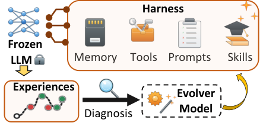

<a href="https://arxiv.org/abs/2605.30621">Harness Updating Is Not Harness Benefit: Disentangling Evolution Capabilities in Self-Evolving LLM Agents</a>

<b>Minhua Lin</b>*, Juncheng Wu*, Zijun Wang, Zhan Shi, Yisi Sang, Bing He, Zewen Liu, Tianxin Wei, Zongyu Wu, Zhiwei Zhang, Dakuo Wang, Xiang Zhang, Benoit Dumoulin, Cihang Xie, Yuyin Zhou, Suhang Wang, Hanqing Lu

<b>RSI-Harness:</b> Separates two capabilities of self-evolving agents, producing useful harness updates and benefiting from them, and shows that the ability to produce updates is largely flat in base capability.

Featured in DAIR.AI's <a href="https://x.com/dair_ai/article/2063644231030214958">Top AI Papers of the Week</a> and discussed in <a href="https://lilianweng.github.io/posts/2026-07-04-harness/">Lilian Weng's blog</a>

Persistent ImprovementRecursive ImprovementReliable Self-ImprovementHarness Evolution

<a href="https://arxiv.org/abs/2605.30621">Paper</a><a href="https://github.com/A-EVO-Lab/a-evolve">Code</a>

Preprint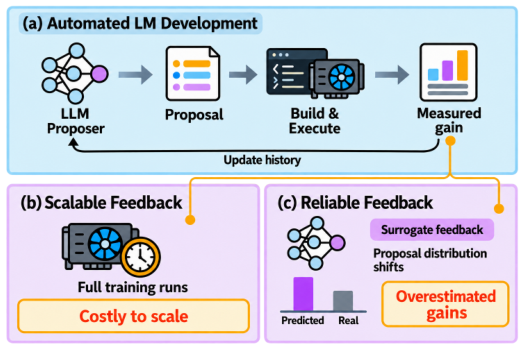

<a href="https://arxiv.org/abs/2610.23344">Language Models Learn to Improve Language Models</a>

<b>Minhua Lin</b>, Zijun Wang, Zewen Liu, Zhaotian Weng, Bing He, Zhan Shi, Benoit Dumoulin, Xiang Zhang, Suhang Wang, Hanqing Lu

<b>RSI-Training:</b> Trains language models to learn, from their own experimental outcomes, which training-recipe changes improve a model, and transfers this judgment to unseen model families.

Persistent ImprovementRecursive ImprovementAutoResearchReinforcement Learning

<a href="https://arxiv.org/abs/2610.23344">Paper</a>

Preprint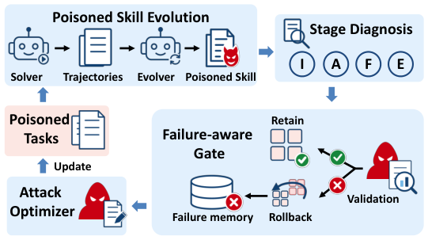

<a href="/files/BadEvolve_Preprint.pdf">BadEvolve: Making Self-Evolving Agents Backdoor Themselves via Failure-Aware Task Poisoning</a>

<b>Minhua Lin</b>, Zongyu Wu, Hanqing Lu, Xianfeng Tang, Xiang Zhang, Qi He, Suhang Wang

<b>RSI-Robustness:</b> Shows that an attacker who only submits poisoned evolution tasks can make a self-evolving agent implant backdoors into its own skills.

Robust Self-ImprovementHarness EvolutionBackdoor Attacks

<a href="/files/BadEvolve_Preprint.pdf">Paper</a><a href="https://github.com/ventr1c/BadEvo">Code</a>

EMNLP 2026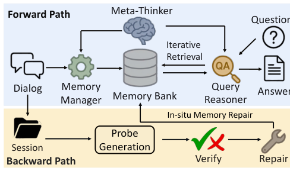

<a href="https://arxiv.org/abs/2603.18718">MemMA: Coordinating the Memory Cycle through Multi-Agent Reasoning and In-Situ Self-Evolution</a>

<b>Minhua Lin</b>, Zhiwei Zhang, Hanqing Lu, Hui Liu, Xianfeng Tang, Qi He, Xiang Zhang, Suhang Wang

<b>RSI-Harness:</b> A plug-and-play multi-agent framework that coordinates memory construction, retrieval, and use, and repairs the memory bank in situ from downstream failures.

Persistent ImprovementHarness EvolutionMulti-Agent

<a href="https://arxiv.org/abs/2603.18718">Paper</a><a href="https://github.com/ventr1c/memma">Code</a>

AgentSkills@CAIS 2026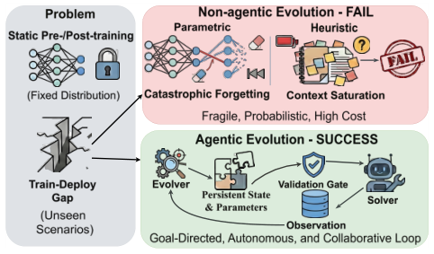

<a href="https://arxiv.org/abs/2602.00359">Position: Agentic Evolution is the Path to Evolving LLMs</a>

<b>Minhua Lin</b>, Hanqing Lu, Zhan Shi, Bing He, Rui Mao, Zhiwei Zhang, Zongyu Wu, Xianfeng Tang, Hui Liu, Zhenwei Dai, Xiang Zhang, Suhang Wang, Benoit Dumoulin, Jian Pei

<b>Open-source Framework:</b> Argues that evolution is a new scaling axis, beyond training- and inference-time compute, for closing the train–deploy gap, and introduces A-Evolve, a framework for agentic evolution.

Persistent ImprovementHarness Evolution

<a href="https://arxiv.org/abs/2602.00359">Paper</a><a href="https://github.com/A-EVO-Lab/A-EVOLVE">Code</a>

ICDM 2026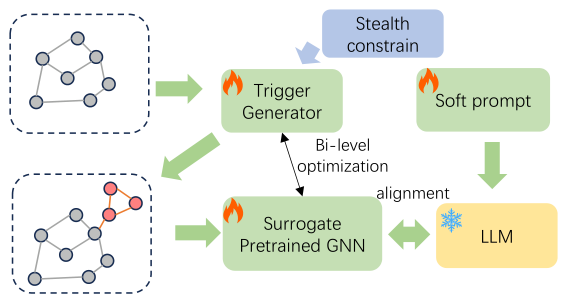

<a href="https://arxiv.org/abs/2608.20991">Trojaning the Alignment: Stealthy Backdoor Attacks against Graph Foundation Models</a>

<b>Minhua Lin</b>*, Zhicheng Gao*, Yilong Wang, Hanqing Lu, Xiang Zhang, Suhang Wang

STAG, a stealthy trojan attack on the graph-language alignment of graph foundation models, with triggers that stay coherent in both node text and graph structure.

Model TrustworthinessBackdoor AttacksGraph Learning

<a href="https://arxiv.org/abs/2608.20991">Paper</a><a href="https://github.com/ventr1c/STAG">Code</a>

ICLR 2026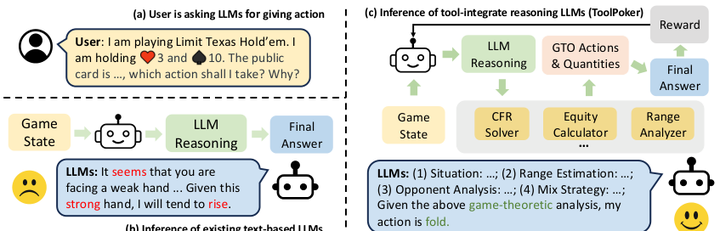

<a href="https://openreview.net/forum?id=vV54ShHvGi">How Far Are LLMs from Professional Poker Players? Revisiting Game-Theoretic Reasoning with Agentic Tool Use</a>

<b>Minhua Lin</b>, Enyan Dai, Hui Liu, Xianfeng Tang, Yuliang Yan, Zhenwei Dai, Jingying Zeng, Zhiwei Zhang, Fali Wang, Hongcheng Gao, Chen Luo, Xiang Zhang, Qi He, Suhang Wang

Finds that LLMs fall short of professional poker play due to heuristic reliance and a knowing–doing gap, and introduces ToolPoker, which consults game-theoretic solvers.

Within-task ImprovementReinforcement LearningTool Use

<a href="https://openreview.net/forum?id=vV54ShHvGi">Paper</a>

TKDD 2026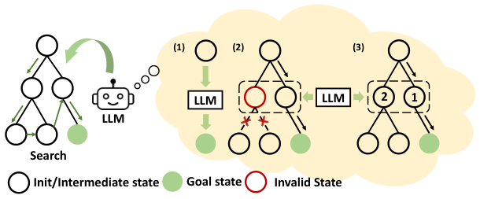

<a href="https://arxiv.org/abs/2502.18387">How Far are LLMs from Real Search? Rethinking the Complementary Roles of Search and Learning</a>

<b>Minhua Lin</b>, Hui Liu, Xianfeng Tang, Jingying Zeng, Zhenwei Dai, Chen Luo, Zheng Li, Xiang Zhang, Qi He, Suhang Wang

Shows that LLMs struggle to search efficiently on complex problems, and introduces SeaL, which combines LLMs with systematic search to cut search spaces by up to 99.1%.

Within-task ImprovementTest-Time Scaling

<a href="https://arxiv.org/abs/2502.18387">Paper</a><a href="https://github.com/ventr1c/SeaL">Code</a>

EACL 2026 Findings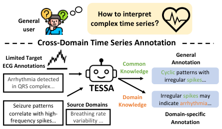

<a href="https://arxiv.org/abs/2410.17462">Decoding Time Series with LLMs: A Multi-Agent Framework for Cross-Domain Annotation</a>

<b>Minhua Lin</b>, Zhengzhang Chen, Yanchi Liu, Xujiang Zhao, Zongyu Wu, Junxiang Wang, Xiang Zhang, Suhang Wang, Haifeng Chen

TESSA, a multi-agent system that generates general and domain-specific annotations for time series across domains.

Multi-Agent

<a href="https://arxiv.org/abs/2410.17462">Paper</a><a href="https://github.com/ventr1c/TESSA">Code</a>

Preprint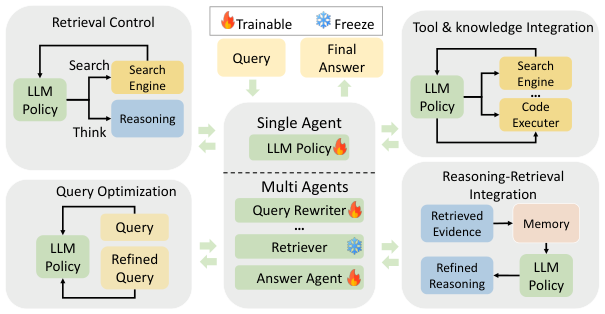

<a href="https://arxiv.org/abs/2510.16724">A Comprehensive Survey on Reinforcement Learning-based Agentic Search: Foundations, Roles, Optimizations, Evaluations, and Applications</a>

<b>Minhua Lin</b>, Zongyu Wu, Zhichao Xu, Hui Liu, Xianfeng Tang, Qi He, Charu Aggarwal, Hui Liu, Xiang Zhang, Suhang Wang

A survey of RL-based agentic search, covering its foundations, the roles RL plays, optimization, evaluation, and applications.

Within-task ImprovementReinforcement LearningTool Use

<a href="https://arxiv.org/abs/2510.16724">Paper</a><a href="https://github.com/ventr1c/Awesome-RL-based-Agentic-Search-Papers">Project</a>

KDD 2025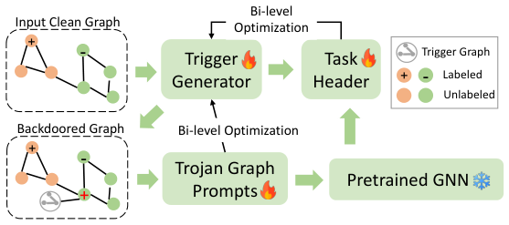

<a href="https://arxiv.org/abs/2410.13974">Are You Using Reliable Graph Prompts? Trojan Prompt Attacks on Graph Neural Networks</a>

<b>Minhua Lin</b>*, Zhiwei Zhang*, Enyan Dai, Zongyu Wu, Yilong Wang, Xiang Zhang, Suhang Wang

Injects backdoors into graph prompts without touching the frozen pre-trained GNN encoder, and keeps them effective after downstream fine-tuning.

Model TrustworthinessBackdoor AttacksGraph Learning

<a href="https://arxiv.org/abs/2410.13974">Paper</a><a href="https://github.com/ventr1c/TPGA">Code</a>

KDD 2025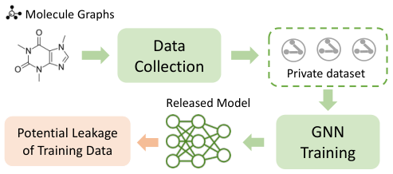

<a href="https://arxiv.org/abs/2411.11197">Stealing Training Graphs from Graph Neural Networks</a>

<b>Minhua Lin</b>, Enyan Dai, Junjie Xu, Jinyuan Jia, Xiang Zhang, Suhang Wang

Shows, in theory and practice, that trained GNN parameters leak their training graphs, and reconstructs high-quality training graphs from them.

Model TrustworthinessGraph Learning

<a href="https://arxiv.org/abs/2411.11197">Paper</a><a href="https://github.com/ventr1c/GraphSteal">Code</a>

NeurIPS 2023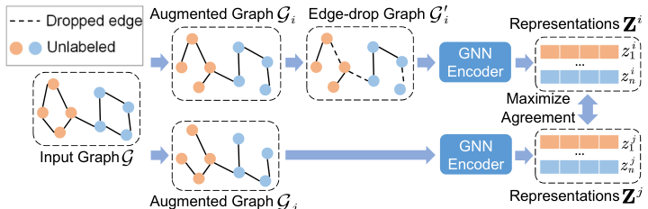

<a href="https://arxiv.org/abs/2310.03312">Certifiably Robust Graph Contrastive Learning</a>

<b>Minhua Lin</b>, Teng Xiao, Enyan Dai, Xiang Zhang, Suhang Wang

The first certifiably robust framework for graph contrastive learning, using randomized edge-drop smoothing that carries over to downstream tasks.

Model TrustworthinessGraph Learning

<a href="https://arxiv.org/abs/2310.03312">Paper</a><a href="https://github.com/ventr1c/RES-GCL">Code</a>

KDD 2025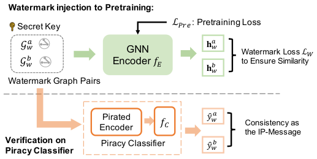

<a href="https://arxiv.org/abs/2402.04435">PreGIP: Watermarking the Pretraining of Graph Neural Networks for Deep Intellectual Property Protection</a>

Enyan Dai*, <b>Minhua Lin</b>*, Suhang Wang

Watermarks the pretraining of GNN encoders for IP protection with a task-free, fine-tuning-resistant watermark.

Model TrustworthinessGraph Learning

<a href="https://arxiv.org/abs/2402.04435">Paper</a><a href="https://github.com/ventr1c/PreGIP">Code</a>

WSDM 2024
Efficient, Direct, and Restricted Black-Box Graph Evasion Attacks to Any-Layer Graph Neural Networks via Influence Function

<a href="https://arxiv.org/abs/2009.00203">Efficient, Direct, and Restricted Black-Box Graph Evasion Attacks to Any-Layer Graph Neural Networks via Influence Function</a>

Binghui Wang*, <b>Minhua Lin</b>*, Tianxiang Zhou, Pan Zhou, Ang Li, Meng Pang, Cai Fu, Hai Li, Yiran Chen

An influence-function-based black-box evasion attack that is efficient and works on GNNs of any depth.

Model TrustworthinessGraph Learning

<a href="https://arxiv.org/abs/2009.00203">Paper</a><a href="https://github.com/ventr1c/InfAttack">Code</a>

WWW 2023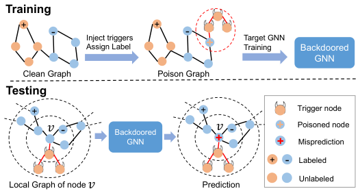

<a href="https://arxiv.org/abs/2303.01263">Unnoticeable Backdoor Attacks on Graph Neural Networks</a>

Enyan Dai*, <b>Minhua Lin</b>*, Xiang Zhang, Suhang Wang

Graph backdoor attacks that succeed with a limited budget while producing triggers that are hard to detect and prune.

Model TrustworthinessBackdoor AttacksGraph Learning

<a href="https://arxiv.org/abs/2303.01263">Paper</a><a href="https://github.com/ventr1c/UGBA">Code</a>

<!-- SELECTED-PUBS:END -->

## Honors and Awards
* ICDM Student Travel Award (2026)
* IST College Travel Award (2025, 2026)
* KDD Student Travel Award (2025)
* SIGIR Student Travel Award for WSDM (2024)
* NeurIPS Scholar Award (2023)

## Service
* **Organizing Committee**: Social Media / Publicity Chair, [KDD 2027](https://kdd2027.kdd.org/acm-kdd-2027-organizing-committee/)
* **Program Committee Member**: KDD (2024, 2025, 2026, 2027), AAAI (2026, 2027)
* **Reviewer**: ICML (2025, 2026), ICLR (2025, 2026, 2027), NeurIPS (2023, 2024, 2025, 2026), ACL ARR (2024, 2025, 2026), WWW (2024, 2025, 2027), SIGIR (2024, 2025), CIKM (2023, 2024), RecSys (2023, 2024), WSDM (2023), MM (2024), PAKDD (2024), TKDE, TKDD, Neurocomputing, Neural Networks, DMLR

<!-- Preprints
====== -->

<!--  -->

